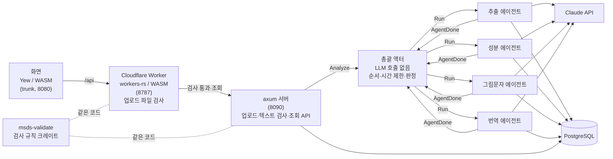

# msds-agent

MSDS(물질안전보건자료) PDF를 올리면 구성성분과 CAS 번호, GHS 그림문자, 한국어 번역을 만들어 주는 Rust 에이전트 시스템입니다.

- **입력**: 영문·한글 MSDS PDF (한 파일에 제품 여러 개가 이어 붙은 문서, 2·3번 섹션 순서가 다른 옛 양식 포함)
- **출력**
  - 제품별 구성성분·CAS 번호·함유량 (원문 표기 그대로, CAS 체크섬 검증 결과 포함)
  - GHS 그림문자와 근거 H코드·신호어 (H코드도 분류도 없는 GHS 이전 양식은 추측하지 않고 이유를 남김)
  - 16개 섹션의 한국어 번역 (한글 문서는 생략)
  - 기존 MSDS 서비스와 같은 모양의 호환 응답 (기존 클라이언트가 주소만 바꿔 결과를 비교할 수 있게)
- **구성**: Yew 화면 → Cloudflare Worker(업로드 검사) → axum 서버 → 총괄 액터 → 기능별 에이전트 4개

> 스크린샷은 추후 추가

---

## 구조



분석 흐름: 업로드 → 총괄 액터에 `Analyze` → 추출 에이전트 → 추출이 성공하면 성분·그림문자·번역 에이전트를 동시에 실행 → 결과를 모아 상태 판정(완료 / 부분 완료 / 실패).
메시지에는 문서 ID·실행 번호·마감 시각만 담고, 결과는 각 에이전트가 자기 저장 툴로 DB에 직접 씁니다.

---

## 핵심 설계

### LLM과 코드의 역할 나누기
- **추출**: LLM은 섹션 제목의 *위치*만 고릅니다(어느 줄이 몇 번 섹션인지, 표준 GHS 번호로). 본문은 코드가 그 위치로 잘라 저장하므로 LLM이 본문을 옮겨 적다 생기는 누락·변형이 없습니다.
- **성분**: 성분명·CAS·함유량은 원문 표기 그대로 저장합니다. 저장 툴이 CAS 체크섬을 검사해 틀리면 오류로 돌려주고, 모델은 원문을 다시 읽어 *잘못 읽은 것만* 고칩니다. 원문 자체가 틀린 CAS(엑셀이 날짜로 바꾼 값 등)는 고치지 않고 "체크섬 오류"로 남깁니다.
- **그림문자**: LLM은 문서에 적힌 H코드·분류·신호어를 옮기기만 하고, 그림문자는 코드가 결정적인 대응표와 KOSHA 경고표지 작성 지침(W-14-2022)의 생략 우선순위로 정합니다. H코드도 분류도 없는 문서는 추측하지 않고 "분류 정보 없음"과 이유를 저장합니다.

### 에이전트별 액터와 총괄 액터
- 에이전트마다 자기 시스템 프롬프트(순서가 아니라 목표)와 자기 툴만 가진 액터입니다. 툴 루프는 직접 구현했고(최대 10라운드), 성공 여부는 모델의 답이 아니라 코드가 DB를 보고 판정합니다.
- 총괄 액터는 LLM을 부르지 않는 순수 상태 기계(`Pipeline`)로, 실행마다 `run_id`를 붙여 이전 실행의 늦은 응답을 무시합니다. 문서당 10분 제한(넘으면 끝난 결과로 부분 완료 판정), 동시 분석 3건(넘으면 대기열), 서버 재시작 때 중단된 문서는 실패로 복구합니다.

### 번역: 툴 루프 없이 조각 번역
- 읽기·저장 순서에 판단이 필요 없어 툴 루프를 쓰지 않습니다. 코드가 섹션을 6,000자 조각으로 나눠 조각마다 한 번 호출합니다(툴 루프 대비 입력 토큰 약 1/6.6).
- 페이지 머리말·꼬리말을 빼고 번역하며, 사후 검사로 CAS·H/P코드·제품명 보존, 한자·가나 혼입, "원문 → 번역" 쌍 형식을 확인합니다. 경고가 난 조각은 한 번만 다시 번역해 경고가 적은 쪽을 저장합니다.

### 검사 규칙 하나를 서버와 Worker가 공유
- 업로드 검사(PDF 시그니처 → 20MB → 텍스트 200자 → 섹션 번호 8개)는 `msds-validate` 크레이트 한 곳에만 있고, 서버(네이티브)와 Worker(WASM)가 같은 코드를 씁니다.
- Worker는 시그니처·크기만 검사합니다. 텍스트 검사는 PDF 텍스트 추출이 필요한데, 추출만으로도 네이티브에서 10~244ms가 걸려 Workers Free의 CPU 한도(10ms)를 넘기 때문에 서버에 둡니다. 큰 업로드는 본문을 읽기 전에 `Content-Length`로 거릅니다.

### 기존 서비스 호환 응답
- 기존 서비스의 원본 코드를 기준으로 결과 종류 코드(201 혼합물·여러 제품 / 401 성분 없음 / 203 CAS 없음·비공개 / 200 단일물질)와 응답 모양을 맞췄습니다.
- 동기식 엔드포인트는 업로드부터 판정까지 기다린 뒤 같은 모양으로 응답합니다.

---

## 실측 결과

샘플 MSDS 10건을 모두 Claude Sonnet(claude-sonnet-5-5)으로, 동시 분석 3건·문서당 제한 10분 설정에서 한꺼번에 재분석했습니다.

| 항목 | 결과 |
|---|---|
| 완료 | **10 / 10** (부분 완료·실패 0) |
| 10건 전체 소요 | **2분 32초** (첫 요청 → 마지막 에이전트 종료) |
| 문서당 평균 | 35초, $0.25 |
| 문서당 최대 | 89초, $0.64 (영문 51쪽·2제품) |
| 추정 비용 합계 | $2.51 (입력 61만 토큰, 출력 13만 토큰) |
| 비용 비중 | 번역 61% · 추출 16% · 그림문자 12% · 성분 11% |
| 원문 자동 대조 불일치 | **0건** (측정 규칙 보정 후. 보정 전 후보 1건은 원문 확인 결과 EU 색인번호) |
| 번역 사후 검사 경고 | 2건(한자 혼입) → 경고 난 조각만 1회 재번역 도입. 두 문서 재분석에서 **0건**(재번역이 실제로 작동한 것은 1건) |

| 문서 | 언어 | 쪽 | 제품 | 양식·특징 | 시간 | 비용 |
|---|---|---|---|---|---|---|
| 1 | 한글 | 5 | 1 | GHS (GHS05·06·08) | 15.0s | $0.086 |
| 2 | 한글 | 7 | 1 | GHS (GHS07), 원문 CAS 오류 1건 | 18.5s | $0.088 |
| 3 | 한글 | 14 | 1 | GHS (GHS05·06·08) | 13.2s | $0.085 |
| 4 | 영문 | 4 | 1 | 옛 양식(2·3번 순서 다름), GHS 이전 | 24.8s | $0.185 |
| 5 | 영문 | 6 | 1 | GHS 이전 (HMIS만) | 22.3s | $0.164 |
| 6 | 영문 | 6 | 1 | GHS (GHS05·07), 성분 전부 비공개 | 22.6s | $0.184 |
| 7 | 영문 | 13 | 3 | 다중 제품, 옛 양식, GHS 이전 | 62.6s | $0.476 |
| 8 | 영문 | 14 | 1 | GHS (GHS02·07·08) | 38.3s | $0.298 |
| 9 | 영문 | 17 | 1 | GHS (그림문자 없는 H코드만) | 43.7s | $0.294 |
| 10 | 영문 | 51 | 2 | 다중 제품, GHS (GHS05·07·09) | 89.0s | $0.644 |

- 한글 문서는 번역을 건너뛰어 비용이 영문의 절반 이하입니다.
- 정답 데이터가 없어 원문 텍스트와 자동 대조했습니다(`cargo run -- measure report`): 저장된 CAS가 원문에 있는지, 성분 섹션의 CAS 모양 문자열 중 빠진 것이 있는지, 유해성 섹션의 H코드와 저장값의 차이. 줄이 나뉘거나 공백이 낀 CAS도 정규화해 찾습니다. **성분명·함유량이 올바른 CAS와 짝지어졌는지는 자동으로 확인하지 않습니다.**

---

## 기술 스택과 크레이트

| 크레이트 | 위치 | 내용 |
|---|---|---|
| `msds-agent` | `/` | axum 서버, 액터(총괄·에이전트 4개), 툴, PDF 추출, 측정 명령 |
| `msds-validate` | `msds-validate/` | 업로드 검사 규칙(순수 함수, DB·IO 없음). 서버·Worker 공용 |
| `msds-frontend` | `frontend/` | Yew 화면 (따로 빌드) |
| `msds-worker` | `worker/` | Cloudflare Worker 앞단 (따로 빌드) |

- **서버**: Rust 2021, tokio, axum 0.7, sqlx 0.8, pdf-extract(좌표 기반 줄 정렬은 직접 구현)
- **액터·LLM**: pekko-actor(액터 시스템), pekko-agent(LLM 클라이언트·툴 레지스트리), Claude API
- **DB**: PostgreSQL 16 (docker compose)
- **화면**: Yew 0.21, yew-router, Tailwind CSS 3.4.17, trunk
- **Worker**: workers-rs 0.8.7, wrangler 4.149.0 (로컬 `wrangler dev`만 사용)
- **테스트**: `cargo test --workspace` (서버 106 + msds-validate 9 = 115개)

---

## 실행 방법

### 1. 폴더 배치
액터·에이전트 라이브러리를 경로 의존으로 씁니다. 아래 구조와 커밋으로 맞춥니다.

```
Agentic_AI/
├── pekko-agent/   yhc007/pekko-agent @ db20850
├── rust-pekko/    daseul312/rust-pekko @ 10c9c42
│   └── coredb/    yhc007/coredb @ a2bba2c
└── msds-agent/    이 저장소
```
```
git -C <폴더> checkout <커밋>
```

### 2. 준비
- Rust (Windows는 Visual Studio Build Tools의 C++ 포함), Docker Desktop, Node.js(npx)
- 화면·Worker용: `rustup target add wasm32-unknown-unknown`, `cargo install trunk worker-build`

### 3. 환경 변수와 DB
```
cp .env.example .env      # CLAUDE_API_KEY, CLAUDE_MODEL 입력 (CLAUDE_MODEL이 비면 서버가 시작하지 않음)
docker compose up -d      # PostgreSQL (localhost:5433, DB msds)
```
에이전트별 모델(`CLAUDE_MODEL_EXTRACT` 등), 동시 분석 수, 시간 제한은 `.env.example`의 주석을 참고합니다.

### 4. 실행 (터미널 3개)
```
cargo run                         # 서버 http://localhost:8090 (테이블은 시작 때 자동 생성)
cd worker && npm run dev          # Worker http://localhost:8787
cd frontend && trunk serve        # 화면 http://localhost:8080 (/api는 Worker로)
```

### 5. 테스트와 개발용 명령
```
cargo test --workspace                                         # 단위 테스트
cargo run -- pipeline-test <doc_id>                            # 서버 없이 전체 분석 1건, 에이전트별 시간·토큰·비용 출력
cargo run -- agent-test <extract|components|both|hazards|translate> <doc_id>
cargo run -- measure report --since <시각> --requests <파일> --out <폴더>   # 실측 집계·원문 대조
```

---

## API

| 메서드 | 경로 | 설명 |
|---|---|---|
| POST | `/api/msds/upload` | multipart `file`. 검사·저장 후 분석을 대기열에 넣고 바로 응답 (`status: "queued"`). 검사 실패는 400 `{"error"}` |
| GET | `/api/msds` | 문서 목록 (최신순) |
| GET | `/api/msds/:id` | 상세: 제품별 성분·그림문자·신호어, 섹션별 번역, 에이전트별 실행 결과(시간·토큰·추정 비용) |
| GET | `/api/msds/:id/pages` | 추출한 페이지 미리보기 |
| POST | `/api/msds/:id/analyze` | 재분석. 202, 없는 문서 404, 분석 중이면 409 |
| GET | `/api/msds/:id/legacy` | 기존 서비스 호환 모양. 분석 중이면 409 |
| POST | `/api/legacy/casNoExtraction` | 기존 서비스 호환 동기식: 업로드부터 판정까지 기다린 뒤 호환 모양으로 응답 |

**문서 상태**

| 값 | 뜻 |
|---|---|
| `uploaded` | 업로드됨 (분석 전) |
| `queued` | 분석 대기열 |
| `analyzing` | 분석 중 |
| `done` | 완료 (성분·그림문자·번역 모두 성공) |
| `partial` | 부분 완료 (일부 에이전트 실패 또는 시간 초과) |
| `failed` | 실패 (업로드 검사 실패, 추출 실패, 모든 에이전트 실패, 서버 재시작으로 중단) |

호환 응답의 `status`는 진행 상태가 아니라 결과 종류입니다: 200 단일물질 · 201 혼합물/여러 제품 · 203 CAS 없음/비공개 · 401 성분 없음 · 400 입력 오류.

---

## 알려진 한계와 다음 작업

- **스캔본(이미지 PDF) 미지원**: 텍스트가 200자 미만이면 업로드 단계에서 거부합니다. OCR은 아직 없습니다.
- **그림문자 이미지 블록 미지원**: 그림문자는 문서의 H코드·분류로만 판단합니다.
- **정답 데이터 없는 정확도 대조**: 자동 대조는 원문과의 일치만 봅니다. 성분명·함유량과 CAS의 짝, 번역 품질은 사람이 확인해야 합니다. 정답 세트를 만들어 정밀도·재현율을 재는 것이 다음 작업입니다.
- **번역 핵심 요약 섹션**: 16개 섹션 전체 번역 외에 유해성·응급조치·취급 같은 핵심만 모은 요약을 추가할 계획입니다.
- **CAS 추정 제안**: 체크섬 오류로 표시된 성분에 한해, 원문 값은 그대로 두고 "추정 CAS"를 별도 제안으로 보여 주는 기능을 검토 중입니다. 원문에 CAS가 없는 성분은 추측 금지 원칙에 따라 추정하지 않습니다.

---

## 그림문자 이미지 출처

`frontend/assets/ghs/GHS01.png` ~ `GHS09.png`는 미국 OSHA(Occupational Safety and Health Administration)의 Hazard Communication 그림문자입니다.

- 출처: https://www.osha.gov/hazcom/pictograms
- 각 이미지 표기: "Photo Credit: OSHA | Copyright: Public Domain" (미국 연방정부 저작물)
- GHS09만 원본 3660px을 1017px로 축소했고, 나머지는 원본 그대로입니다. 자세한 대응표는 [frontend/README.md](frontend/README.md)에 있습니다.
